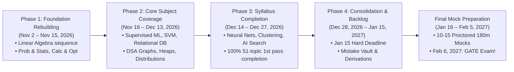

# GATE 2027 Command Centre: Complete Syllabus & Personalized Execution Plan

> **Target Examination:** GATE 2027 — Data Science & Artificial Intelligence (DA)  
> **Exam Date:** February 6, 2027 (09:30 AM IST)  
> **Preparation Start Date:** November 2, 2026  
> **Syllabus Target Completion Deadline:** January 15, 2027 (Hard Deadline)  
> **Total Curriculum Scope:** 7 Subjects | 20 Chapters | 51 Topics | 299 Estimated Focused Hours  
> **Weekly Study Capacity:** 39.0 Focused Hours (Mon–Sat: 6.0h / day, Sun: 3.0h revision)  
> **Primary Target:** 80+ Marks (All India Rank < 100)  
> **Timezone:** Asia/Kolkata (IST)  
> **Tracking Portal:** [https://sankeerth28.github.io/GATE-Command-Centre/](https://sankeerth28.github.io/GATE-Command-Centre/)

---

## 1. Executive Summary & Strategy Overview

The **GATE Command Centre** is engineered to replace vague, disorganized exam prep with an automated, algorithmically balanced study and revision system tailored specifically for **GATE DA 2027**.

The preparation model is built on five core operational pillars:
1. **Official GATE DA Syllabus Coverage:** All 7 official subjects and 51 topics mapped with explicit subtopic checklists, weightages, and difficulty ratings.
2. **Weekly 39-Hour Timetable Matrix:** A balanced multi-subject weekly allocation distributing 39 hours across the 7 subjects (Probability & Statistics 6h, Linear Algebra 6h, Calculus & Optimization 4.5h, Programming & DSA 6h, DBMS 5h, Machine Learning & AI 7h, General Aptitude 4.5h).
3. **Phase-Driven Milestone Progression:** Four strict preparation phases spanning Nov 2, 2026 to Jan 15, 2027, followed by a dedicated Full-Length Mock Examination period (Jan 16 – Feb 5, 2027) targeting 10–15 proctored mocks.
4. **Linear Algebra Foundational Rebuilding:** Rigorous re-assessment and sequential coverage of Linear Algebra across 6 core modules before advanced ML applications.
5. **Zero-Loss Mistake Vault & Spaced Repetition (SRS):** Incomplete questions are tagged by 5 root causes in the Mistake Vault, while Leitner SRS mathematically schedules topic revisions at 1, 3, 7, 14, 30, and 90-day intervals.

---

## 2. Official GATE DA Syllabus Breakdown

```
Total Curriculum Scope: 299 Hours | 51 Topics | 100 Marks
├── 1. Probability & Statistics (PROB_STAT)       [16 Marks | 8 Topics  | 48 Hours]
├── 2. Linear Algebra (LIN_ALG)                   [14 Marks | 6 Topics  | 37 Hours]
├── 3. Calculus & Optimization (CALC_OPT)         [12 Marks | 6 Topics  | 34 Hours]
├── 4. Programming, Data Structures (PROG_DSA)    [16 Marks | 8 Topics  | 47 Hours]
├── 5. Database Management & Warehousing (DBMS)   [12 Marks | 7 Topics  | 39 Hours]
├── 6. Machine Learning & AI (ML_AI)              [16 Marks | 10 Topics | 61 Hours]
└── 7. General Aptitude (GEN_APT)                 [15 Marks | 6 Topics  | 33 Hours]
```

### Subject Overview & Diagnostic Weights

| Code | Subject Name | Exam Weight | Baseline Diagnostic | Chapters | Topics | Est. Hours |
| :--- | :--- | :---: | :--- | :---: | :---: | :---: |
| `PROB_STAT` | **Probability and Statistics** | 16% | **Weak** (Foundational priority) | 3 | 8 | 48.0 h |
| `LIN_ALG` | **Linear Algebra** | 14% | **Intermediate** (Requires rigor & PYQs) | 2 | 6 | 37.0 h |
| `CALC_OPT` | **Calculus and Optimization** | 12% | **Weak** (High mathematical friction) | 2 | 6 | 34.0 h |
| `PROG_DSA` | **Programming, DSA** | 16% | **Intermediate** (Python & algorithmic speed) | 3 | 8 | 47.0 h |
| `DBMS_DWH` | **Database Management & DWH** | 12% | **Weak** (Relational algebra & SQL focus) | 3 | 7 | 39.0 h |
| `ML_AI` | **Machine Learning & AI** | 16% | **Intermediate** (Mathematical derivations) | 3 | 10 | 61.0 h |
| `GEN_APT` | **General Aptitude** | 15% | **Intermediate** (Weekly speed practice) | 3 | 6 | 33.0 h |
| **TOTAL** | **Full GATE DA Curriculum** | **100%** | **Personalized Dynamic Balance** | **19** | **51** | **299.0 h** |

---

## 3. Comprehensive Topic & Subtopic Catalog

### Subject 1: Probability and Statistics (`PROB_STAT`)
- **Exam Weightage:** 16.0%  
- **Diagnostic Baseline:** Weak — High-priority foundational sequence  
- **Estimated Study Time:** 48.0 Hours across 8 Topics  

#### Chapter 1.1: Probability Theory
1. **Counting and Combinatorics** [4.0 h | Priority: Medium | Difficulty: Medium]
   - Permutations and Combinations
   - Pigeonhole Principle
   - Inclusion-Exclusion Principle
2. **Axioms of Probability & Conditional Probability** [5.0 h | Priority: High | Difficulty: Medium]
   - Sample Space, Events, and Kolmogorov Probability Axioms
   - Conditional Probability and Independence of Events
   - Law of Total Probability
   - Bayes' Theorem, Priors, and Posterior Odds

#### Chapter 1.2: Random Variables & Distributions
3. **Discrete Random Variables & Distributions** [7.0 h | Priority: High | Difficulty: Medium]
   - Probability Mass Function (PMF) and Cumulative Distribution Function (CDF)
   - Expectation, Variance, and Higher Moments
   - Bernoulli and Binomial Distributions
   - Poisson and Geometric Distributions
4. **Continuous Random Variables & Distributions** [8.0 h | Priority: High | Difficulty: Hard]
   - Probability Density Function (PDF), CDF, and Quartiles
   - Continuous Expectation, Variance, and Standard Deviation
   - Uniform Distribution
   - Normal (Gaussian) Distribution and Standard Normal ($Z$-scores)
   - Exponential Distribution and Memoryless Property
5. **Joint Probability Distributions** [7.0 h | Priority: High | Difficulty: Hard]
   - Joint, Marginal, and Conditional PMF and PDF
   - Independence of Multiple Random Variables
   - Covariance and Pearson Correlation Coefficient
   - Conditional Expectation, Conditional Variance, and Law of Total Variance

#### Chapter 1.3: Mathematical Statistics & Inference
6. **Limit Theorems & Inequalities** [5.0 h | Priority: High | Difficulty: Medium]
   - Markov's Inequality and Chebyshev's Inequality
   - Weak and Strong Law of Large Numbers (WLLN & SLLN)
   - Central Limit Theorem (CLT) and Asymptotic Normality
7. **Statistical Estimation & Inference** [6.0 h | Priority: High | Difficulty: Hard]
   - Point Estimation, Bias, and Unbiasedness
   - Maximum Likelihood Estimation (MLE) for Common Distributions
   - Confidence Intervals for Population Means and Proportions
8. **Hypothesis Testing** [6.0 h | Priority: High | Difficulty: Hard]
   - Null and Alternative Hypotheses, Type I ($\alpha$) and Type II ($\beta$) Errors
   - Significance Levels, Critical Regions, and $p$-Values
   - $z$-Test and One-Sample / Two-Sample $t$-Tests
   - Chi-Square ($\chi^2$) Goodness-of-Fit and Independence Tests

---

### Subject 2: Linear Algebra (`LIN_ALG`)
- **Exam Weightage:** 14.0%  
- **Diagnostic Baseline:** Intermediate — Needs conceptual rigor and computational practice  
- **Estimated Study Time:** 37.0 Hours across 6 Topics  

#### Chapter 2.1: Vector Spaces & Linear Systems
1. **Vector Spaces and Subspaces** [6.0 h | Priority: High | Difficulty: Medium]
   - Vector Space Axioms and Real Euclidean Spaces ($\mathbb{R}^n$)
   - Vector Subspaces and Span of a Set
   - Linear Independence and Linear Dependence
   - Basis, Dimension, and Coordinate Vectors
2. **Matrices & Systems of Linear Equations** [6.0 h | Priority: High | Difficulty: Medium]
   - Elementary Row Operations and Row Echelon Form (REF / RREF)
   - Gaussian Elimination and Gauss-Jordan Solvers
   - Rank, Nullity, and the Fundamental Rank-Nullity Theorem
   - Consistency Conditions ($Ax = b$) and Solution Uniqueness

#### Chapter 2.2: Transformations, Eigenvalues & Factorizations
3. **Linear Transformations & Matrix Representations** [5.0 h | Priority: Medium | Difficulty: Medium]
   - Kernel (Null Space) and Range (Column Space) of Linear Transformations
   - Matrix Representation with Respect to Arbitrary Bases
   - Change of Basis Matrices and Similarity Transformations
4. **Eigenvalues, Eigenvectors & Diagonalization** [7.0 h | Priority: High | Difficulty: Hard]
   - Characteristic Polynomial, Eigenvalues, and Eigenvectors
   - Algebraic Multiplicity vs. Geometric Multiplicity
   - Matrix Diagonalization and Defective Matrices
   - Spectral Theorem for Real Symmetric Matrices
   - Trace, Determinant, Matrix Powers, and Cayley-Hamilton Theorem
5. **Orthogonality & Projections** [6.0 h | Priority: High | Difficulty: Medium]
   - Inner Products, Norms, Angles, and Orthogonality
   - Cauchy-Schwarz and Triangle Inequalities
   - Orthogonal and Orthonormal Sets
   - Gram-Schmidt Orthogonalization Process
   - Orthogonal Projections and Least-Squares Solutions
6. **Advanced Factorizations & SVD** [7.0 h | Priority: High | Difficulty: Hard]
   - Singular Value Decomposition ($A = U \Sigma V^T$)
   - Singular Values, Left/Right Singular Vectors
   - Low-Rank Matrix Approximations and Connection to PCA
   - LU Decomposition and Cholesky Factorization for Positive-Definite Matrices

---

### Subject 3: Calculus and Optimization (`CALC_OPT`)
- **Exam Weightage:** 12.0%  
- **Diagnostic Baseline:** Weak — Foundational math with steep optimization curve  
- **Estimated Study Time:** 34.0 Hours across 6 Topics  

#### Chapter 3.1: Single Variable Calculus
1. **Limits, Continuity and Differentiability** [5.0 h | Priority: Medium | Difficulty: Medium]
   - Limits, One-Sided Limits, and Indeterminate Forms (L'Hôpital's Rule)
   - Continuity and Types of Discontinuities
   - Differentiability, Chain Rule, and Implicit Differentiation
   - Rolle's Theorem and Lagrange's Mean Value Theorem
2. **Taylor Series & Local Approximations** [4.0 h | Priority: Medium | Difficulty: Medium]
   - Taylor and Maclaurin Series Expansions
   - Linear and Quadratic Approximations
   - Remainder Terms, Error Bounds, and Convergence
3. **Maxima and Minima of Single Variable** [5.0 h | Priority: High | Difficulty: Medium]
   - Critical Points and Fermat's Theorem
   - First and Second Derivative Tests
   - Concavity, Convexity, and Points of Inflection
   - Global Extrema on Closed Bounded Intervals

#### Chapter 3.2: Multivariable Calculus & Numerical Optimization
4. **Partial Derivatives & Gradient Vectors** [6.0 h | Priority: High | Difficulty: Medium]
   - Partial Derivatives and Higher-Order Partial Derivatives
   - Gradient Vector ($\nabla f$) and Directional Derivatives
   - Direction of Steepest Ascent / Descent
   - Hessian Matrix and Multivariable Second Derivative Test
5. **Unconstrained & Constrained Optimization** [7.0 h | Priority: High | Difficulty: Hard]
   - Unconstrained Extrema of Multivariable Functions
   - Positive Definiteness, Negative Definiteness, and Saddle Points
   - Lagrange Multipliers for Equality-Constrained Optimization
   - Karush-Kuhn-Tucker (KKT) Necessary Conditions for Inequality Constraints
   - Convex Sets, Convex Functions, and Global Optimality
6. **Gradient Descent & Numerical Algorithms** [7.0 h | Priority: High | Difficulty: Hard]
   - First-Order Gradient Descent Iterations and Learning Rates
   - Convergence Guarantees on Convex vs. Non-Convex Surfaces
   - Stochastic Gradient Descent (SGD) and Mini-Batch SGD
   - Momentum-Based Updates and Second-Order Newton-Raphson Method

---

### Subject 4: Programming, Data Structures & Algorithms (`PROG_DSA`)
- **Exam Weightage:** 16.0%  
- **Diagnostic Baseline:** Intermediate — High scoring potential with proper practice  
- **Estimated Study Time:** 47.0 Hours across 8 Topics  

#### Chapter 4.1: Python Programming Foundations
1. **Python Data Structures & OOP** [6.0 h | Priority: High | Difficulty: Medium]
   - Python Primitives: Lists, Tuples, Sets, and Dictionaries (Hash Maps)
   - Mutability, References, Memory Model, and Shallow vs. Deep Copy
   - List and Dictionary Comprehensions, Generators, and Iterators
   - Classes, Objects, Inheritance, and Method Overriding
2. **Control Flow, Functions & Recursion** [5.0 h | Priority: Medium | Difficulty: Medium]
   - Conditional Statements and Loops (`for`, `while`, `break`, `continue`)
   - Function Signatures, `*args`, `**kwargs`, and Scope (LEGB Rule)
   - Recursive Functions, Base Cases, and Recursion Trees
   - Call Stack, Stack Overflow, and Tail Recursion Concepts

#### Chapter 4.2: Classical Data Structures
3. **Linear Data Structures** [6.0 h | Priority: High | Difficulty: Medium]
   - Singly and Doubly Linked Lists (Insertion, Deletion, Reversal)
   - Stacks: Array and Linked List Implementations
   - Expression Evaluation: Infix, Prefix, and Postfix Conversion
   - Queues, Circular Queues, and Double-Ended Queues (Deque)
4. **Trees & Binary Search Trees** [7.0 h | Priority: High | Difficulty: Hard]
   - Binary Trees: Properties, Depth, Height, and Node Counts
   - Traversals: Inorder, Preorder, Postorder, and Level-Order
   - Binary Search Trees (BST): Search, Insertion, and Deletion
   - Balanced Trees Overview (AVL and Red-Black Height Balances)
5. **Heaps, Priority Queues & Hashing** [6.0 h | Priority: High | Difficulty: Medium]
   - Binary Min-Heaps and Max-Heaps (Array Representation)
   - Heapify Algorithm, Insert, and Extract-Min Operations
   - Hash Functions and Hash Tables
   - Collision Resolution: Separate Chaining vs. Open Addressing (Linear, Quadratic, Double Hashing)

#### Chapter 4.3: Algorithm Design & Analysis
6. **Asymptotic Analysis & Recurrences** [5.0 h | Priority: High | Difficulty: Medium]
   - Big-$O$, Big-$\Omega$, and Big-$\Theta$ Notations and Limits
   - Time and Space Complexity Analysis of Code Snippets
   - Recurrence Relations: Substitution and Recursion Tree Methods
   - Master Theorem for Divide-and-Conquer Recurrences
7. **Sorting and Searching Algorithms** [6.0 h | Priority: High | Difficulty: Medium]
   - Comparison Sorts: Merge Sort, Quick Sort (Partitioning, Best/Worst Cases), and Heap Sort
   - Non-Comparison Sorts: Counting Sort and Radix Sort
   - Lower Bound for Comparison-Based Sorting ($\Omega(n \log n)$)
   - Linear Search vs. Binary Search and Variations
8. **Graph Algorithms** [6.0 h | Priority: High | Difficulty: Hard]
   - Graph Representations: Adjacency Matrix and Adjacency List
   - Breadth-First Search (BFS) and Shortest Paths in Unweighted Graphs
   - Depth-First Search (DFS), Cycle Detection, and Topological Sorting
   - Minimum Spanning Trees: Kruskal's and Prim's Algorithms
   - Single-Source Shortest Paths: Dijkstra's Algorithm

---

### Subject 5: Database Management & Data Warehousing (`DBMS_DWH`)
- **Exam Weightage:** 12.0%  
- **Diagnostic Baseline:** Weak — Conceptual questions on Normal Forms and ACID  
- **Estimated Study Time:** 39.0 Hours across 7 Topics  

#### Chapter 5.1: Relational Modeling & Query Languages
1. **ER Model and Relational Model** [5.0 h | Priority: Medium | Difficulty: Medium]
   - Entity Sets, Attributes, Relationships, and Cardinality Constraints
   - Extended ER Features: Specialization, Generalization, and Aggregation
   - Converting ER Diagrams to Relational Tables
   - Keys: Super Keys, Candidate Keys, Primary Keys, and Foreign Key Integrity
2. **Relational Algebra & Tuple Relational Calculus** [6.0 h | Priority: High | Difficulty: Hard]
   - Fundamental Relational Algebra Operations: $\sigma$, $\pi$, $\cup$, $-$, $\times$, $\rho$
   - Derived Operations: Joins (Natural, Equi, Theta, Outer Joins), Division ($\div$)
   - Tuple Relational Calculus (TRC) and Domain Relational Calculus (DRC)
   - Relational Completeness and Safe Expressions
3. **Structured Query Language (SQL)** [6.0 h | Priority: High | Difficulty: Medium]
   - DDL, DML, and DCL Statements
   - Complex Multi-Table `JOIN` Queries (Inner, Left, Right, Full Outer)
   - Aggregations: `GROUP BY`, `HAVING`, and Window Functions
   - Subqueries: Nested, Correlated Subqueries, `EXISTS`, `IN`, and Scalar Subqueries

#### Chapter 5.2: Normalization & Transaction Processing
4. **Functional Dependencies & Normal Forms** [7.0 h | Priority: High | Difficulty: Hard]
   - Functional Dependencies (FDs) and Armstrong's Axioms
   - Attribute Closure and Minimal Covers (Canonical Covers)
   - Testing for Candidate Keys
   - Normal Forms: 1NF, 2NF, 3NF, and Boyce-Codd Normal Form (BCNF)
   - Lossless-Join Decomposition and Dependency Preservation Tests
5. **Transactions, Concurrency Control & Recovery** [5.0 h | Priority: High | Difficulty: Hard]
   - ACID Properties of Transactions
   - Serializability: Conflict Serializability and Precedence Graphs
   - View Serializability and Recoverable / Cascadeless Schedules
   - Concurrency Control: Two-Phase Locking (2PL), Strict 2PL, and Deadlocks
   - Log-Based Recovery and Checkpointing Principles

#### Chapter 5.3: Storage Engine & Warehousing
6. **File Organization & B/B+ Trees Indexing** [5.0 h | Priority: High | Difficulty: Hard]
   - Primary, Secondary, and Clustering Indexes
   - Dense vs. Sparse Indexing
   - $B$-Trees: Node Structure, Capacity, and Search Invariants
   - $B^+$ Trees: Internal vs. Leaf Nodes, Range Queries, Insertion, and Deletion Cost Analysis
7. **Data Warehousing & OLAP** [5.0 h | Priority: Medium | Difficulty: Medium]
   - Data Warehouse Architecture and ETL (Extract, Transform, Load)
   - Multidimensional Schemas: Star Schema, Snowflake Schema, and Fact Constellation
   - OLAP Operations: Roll-up, Drill-down, Slice, Dice, and Pivot

---

### Subject 6: Machine Learning & Artificial Intelligence (`ML_AI`)
- **Exam Weightage:** 16.0%  
- **Diagnostic Baseline:** Intermediate — Requires exact mathematical derivations  
- **Estimated Study Time:** 61.0 Hours across 10 Topics  

#### Chapter 6.1: Supervised Learning Models
1. **Linear Regression & Regularization** [6.0 h | Priority: High | Difficulty: Hard]
   - Simple and Multiple Linear Regression Formulations
   - Ordinary Least Squares (OLS) Normal Equations: $\hat{\beta} = (X^T X)^{-1} X^T y$
   - Ridge ($L_2$) Regularization and Closed-Form Solution
   - Lasso ($L_1$) Regularization, Sparsity, and Elastic Net
   - Bias-Variance Decomposition and Cross-Validation Schemes
2. **Classification & Tree Models** [8.0 h | Priority: High | Difficulty: Hard]
   - Logistic Regression, Sigmoid Function, and Log-Odds (Logit)
   - Cross-Entropy Loss and Gradient Updates
   - Decision Trees: Entropy, Information Gain, and Gini Impurity
   - Overfitting, Tree Pruning, and Maximum Depth
   - Ensemble Methods: Bagging, Random Forests, and Gradient Boosted Trees
3. **$k$-Nearest Neighbors & Naive Bayes** [5.0 h | Priority: Medium | Difficulty: Medium]
   - $k$-NN Classification and Regression, Distance Metrics ($L_1$, $L_2$, Minkowski)
   - Effect of $k$, Curse of Dimensionality, and Voronoi Tessellations
   - Bayes Decision Rule and Maximum A Posteriori (MAP) Decision
   - Gaussian Naive Bayes and Multinomial Naive Bayes (Conditional Independence Assumption)
4. **Support Vector Machines (SVM)** [6.0 h | Priority: High | Difficulty: Hard]
   - Linearly Separable Classification and Hyperplane Geometry
   - Margin Formulation: Maximal Margin Classifier
   - Soft-Margin SVM, Slack Variables ($\xi_i$), and Regularization Parameter $C$
   - Dual Formulation and Support Vectors
   - Kernel Trick: Polynomial Kernels and Radial Basis Function (RBF / Gaussian) Kernels

#### Chapter 6.2: Unsupervised Learning & Deep Learning
5. **Clustering Algorithms** [6.0 h | Priority: Medium | Difficulty: Medium]
   - $k$-Means and $k$-Means++ Initialization Algorithms
   - Objective Function (Within-Cluster Sum of Squares) and Elbow Method
   - Silhouette Score Analysis
   - Hierarchical Clustering: Agglomerative, Linkage Criteria (Single, Complete, Average), and Dendrograms
   - Density-Based Spatial Clustering of Applications with Noise (DBSCAN)
6. **Dimensionality Reduction & PCA** [5.0 h | Priority: High | Difficulty: Hard]
   - High-Dimensional Geometry and Curse of Dimensionality
   - Principal Component Analysis (PCA) Mathematical Formulation
   - Sample Covariance Matrix, Eigenvalue Decomposition, and Orthogonal Projection
   - Proportion of Explained Variance and Reconstruction Error
7. **Multilayer Perceptron & Neural Networks** [7.0 h | Priority: High | Difficulty: Hard]
   - Artificial Neurons, Perceptron Learning Algorithm, and Linear Inseparability (XOR)
   - Multilayer Perceptron (MLP) Architecture and Universal Approximation Theorem
   - Activation Functions: Sigmoid, Hyperbolic Tangent ($\tanh$), ReLU, Leaky ReLU, Softmax
   - Loss Functions: Mean Squared Error (MSE), Binary Cross-Entropy, Categorical Cross-Entropy
8. **Backpropagation & Deep Learning Optimization** [7.0 h | Priority: High | Difficulty: Hard]
   - Backpropagation Algorithm: Vectorized Chain Rule and Error Gradient Propagation
   - Optimization Algorithms: Stochastic Gradient Descent (SGD), Momentum, RMSprop, Adam
   - Regularization Techniques: Dropout, $L_1$/$L_2$ Weight Decay, and Batch Normalization
   - Vanishing and Exploding Gradient Phenomena and Initialization (He, Xavier/Glorot)

#### Chapter 6.3: Artificial Intelligence & Search
9. **Search Algorithms & Heuristics** [6.0 h | Priority: High | Difficulty: Medium]
   - Problem Formulation: State Space, Actions, Transition Model, Goal Test, Path Cost
   - Uninformed Search: Breadth-First Search (BFS), Depth-First Search (DFS), Uniform-Cost Search (UCS)
   - Informed (Heuristic) Search: Greedy Best-First Search and $A^*$ Search
   - Heuristic Properties: Admissibility and Consistency (Monotonicity) for $A^*$ Optimality
10. **Adversarial Search & Game Playing** [5.0 h | Priority: Medium | Difficulty: Hard]
    - Zero-Sum Two-Player Complete Information Games
    - Game Trees and Optimal Decisions
    - Minimax Algorithm Formulation and Value Computation
    - Alpha-Beta ($\alpha$-$\beta$) Pruning: Pruning Conditions and Complexity Reductions

---

### Subject 7: General Aptitude (`GEN_APT`)
- **Exam Weightage:** 15.0% (Mandatory for all GATE papers)  
- **Diagnostic Baseline:** Intermediate — High accuracy guaranteed through weekly timed sets  
- **Estimated Study Time:** 33.0 Hours across 6 Topics  

#### Chapter 7.1: Verbal Aptitude
1. **English Grammar & Vocabulary** [5.0 h | Priority: Medium | Difficulty: Easy]
   - English Grammar: Tenses, Prepositions, Conjunctions, and Articles
   - Subject-Verb Agreement and Modifiers
   - Vocabulary, Contextual Synonyms, Antonyms, and Phrasal Verbs
2. **Reading Comprehension & Critical Reasoning** [6.0 h | Priority: High | Difficulty: Medium]
   - Reading Comprehension: Main Idea, Tone, and Contextual Deductions
   - Critical Reasoning: Assumptions, Strengths, and Weaknesses of Arguments
   - Logical Deductions, Syllogisms, and Sentence Ordering

#### Chapter 7.2: Quantitative Aptitude
3. **Numerical Computation & Word Problems** [7.0 h | Priority: High | Difficulty: Medium]
   - Numbers, Percentages, Ratios, and Proportions
   - Profit, Loss, Discount, Simple and Compound Interest
   - Time and Work, Pipes and Cisterns
   - Time, Speed, and Distance; Relative Speed
   - Elementary Permutations, Combinations, and Probability
4. **Data Interpretation & Statistics** [6.0 h | Priority: High | Difficulty: Medium]
   - Data Interpretation from Tables, Bar Charts, Pie Charts, and Line Graphs
   - Summary Descriptive Statistics: Mean, Median, Mode, and Range
   - Inter-Quartile Range and Trend Extrapolation

#### Chapter 7.3: Analytical & Spatial Aptitude
5. **Analytical & Logical Reasoning** [5.0 h | Priority: High | Difficulty: Medium]
   - Linear and Circular Seating Arrangements
   - Blood Relations, Direction Sense, and Coding-Decoding
   - Number and Letter Series Completion, Odd-One-Out
6. **Spatial Aptitude** [4.0 h | Priority: Medium | Difficulty: Medium]
   - 2D and 3D Shape Transformations and Mirror Reflections
   - Paper Folding, Paper Cutting, and Punched Holes
   - Rotation, Grouping of Identical Figures, and Spatial Tessellations

---

## 4. The 5-Phase Personalized Execution Plan



### Phase 1: Foundation Rebuilding (November 2 – November 15, 2026)
- **Primary Objectives:**
  - Rebuild Linear Algebra from fundamentals using the strict 6-module sequence.
  - Begin Probability & Statistics (Combinatorics, Axioms, Conditional Probability).
  - Begin Calculus & Optimization (Limits, continuity, differentiation, single-variable max/min).
  - Continue Programming and DSA (Python syntax, arrays, linked lists, basic sorting).
  - Maintain regular DBMS and ML exposure.
- **Key Milestones:**
  - Linear Algebra vector spaces and row echelon forms consolidated.
  - Baseline confidence reassessment completed for all foundational topics.

### Phase 2: Core Subject Coverage (November 16 – December 13, 2026)
- **Primary Objectives:**
  - Complete the remainder of Linear Algebra (Eigenvalues, SVD, Orthogonality).
  - Progress through continuous probability distributions, joint distributions, and statistical inference.
  - Cover multivariable Calculus, gradients, and unconstrained optimization.
  - Cover DSA trees, heaps, graphs, hashing, and asymptotic analysis.
  - Cover relational algebra, SQL queries, B+ tree indexing, normalization, and ACID transactions.
  - Cover supervised Machine Learning (Linear regression, Logistic regression, SVM, Decision Trees).
- **Key Milestones:**
  - Regular PYQ practice alongside concept learning.
  - $\ge 60\%$ of total syllabus topics marked as learning complete.

### Phase 3: Remaining Syllabus Completion (December 14 – December 27, 2026)
- **Primary Objectives:**
  - Deep Learning and Multi-Layer Perceptrons (Feedforward, backpropagation).
  - Unsupervised learning (PCA, $k$-Means, Hierarchical clustering).
  - AI Search algorithms (Informed/Uninformed, A*, Adversarial minimax search).
  - Remaining DBMS topics (Data Warehousing, ER models, schema design).
  - Remaining Probability topics (Hypothesis testing, limit theorems) and multivariable optimization.
  - Sectional tests and topic-wise PYQs.
- **Key Milestones:**
  - **December 27 Milestone:** 100% first learning pass across all 51 syllabus topics completed.

### Phase 4: Consolidation and Backlog Closure (December 28, 2026 – January 15, 2027)
- **Primary Objectives:**
  - Finish any incomplete topics and resolve pending PYQ queues.
  - Rigorous revision of mathematical derivations and proofs.
  - Systematic resolution of all entries in the Mistake Vault.
  - High-yield sectional tests and weak-topic remediation sprints.
  - Consolidation and memorization of mathematical formula sheets.
- **Key Milestones:**
  - **January 15, 2027:** Hard syllabus closure deadline. Zero unfinished syllabus items beyond this date.

### Final Examination Preparation (January 16 – February 5, 2027)
- **Primary Objectives:**
  - Full-length 180-minute GATE DA mock examinations scheduled on Wednesdays and Saturdays (09:30 AM – 12:30 PM).
  - Dedicated 3-hour mock analysis session following every mock test.
  - Rapid multi-subject revision rotations across all 7 subjects.
  - Elimination of recurring negative marking traps and speed calibration.
- **Target:** At least 10 rigorously analyzed full-length mocks (15 as stretch target).
- **GATE Examination Date:** February 6, 2027 (09:30 AM IST).

---

## 5. Recurring Weekly Timetable (39.0 Focused Hours)

The preparation planner follows a strict weekly 39.0-hour allocation matrix (Monday through Saturday: 6.0 hours/day; Sunday: 3.0 lighter revision hours):

| Day | Capacity | Scheduled Subject Modules & Allocation |
| :--- | :---: | :--- |
| **Monday** | 6.0 h | • Probability and Statistics: 2.0 h<br>• Linear Algebra: 2.0 h<br>• Programming and DSA: 2.0 h |
| **Tuesday** | 6.0 h | • Probability and Statistics: 2.0 h<br>• Calculus and Optimization: 2.0 h<br>• Database Management & DWH: 2.0 h |
| **Wednesday** | 6.0 h | • Linear Algebra: 2.0 h<br>• Machine Learning and AI: 2.0 h<br>• General Aptitude: 1.0 h<br>• Database Management & DWH: 1.0 h |
| **Thursday** | 6.0 h | • Calculus and Optimization: 2.0 h<br>• Programming and DSA: 2.0 h<br>• Machine Learning and AI: 2.0 h |
| **Friday** | 6.0 h | • Probability and Statistics: 2.0 h<br>• Database Management & DWH: 2.0 h<br>• Linear Algebra: 1.0 h<br>• General Aptitude: 1.0 h |
| **Saturday** | 6.0 h | • Machine Learning and AI: 2.0 h<br>• Programming and DSA: 2.0 h<br>• Calculus and Optimization: 0.5 h<br>• General Aptitude: 1.5 h |
| **Sunday** | 3.0 h | • Linear Algebra: 1.0 h<br>• Machine Learning and AI: 1.0 h<br>• General Aptitude: 1.0 h<br>*(Prioritizes weekly revision, PYQ consolidation, backlog reflow & weekly performance analysis)* |
| **TOTAL** | **39.0 h** | **PROB: 6h \| LIN_ALG: 6h \| CALC: 4.5h \| DSA: 6h \| DBMS: 5h \| ML_AI: 7h \| APT: 4.5h** |

### Linear Algebra — Sequential Revision Sequence
Because Linear Algebra is a foundational re-study subject, it is strictly sequenced as follows:
1. **Vector Spaces and Subspaces:** Axioms, Real Euclidean spaces $\mathbb{R}^n$, Subspaces, Linear span, Linear independence/dependence, Basis and dimension.
2. **Matrices and Systems of Linear Equations:** Row echelon form (REF), Reduced REF, Gaussian elimination, Rank-nullity theorem, Consistency ($Ax = b$).
3. **Linear Transformations:** Kernel, image, matrix representation, change of basis, similarity transformations.
4. **Eigenvalues and Eigenvectors:** Characteristic polynomials, algebraic/geometric multiplicity, diagonalization, Cayley-Hamilton theorem.
5. **Orthogonality and Projections:** Inner products, Cauchy-Schwarz, Gram-Schmidt orthogonalization, orthogonal projection matrices, least-squares solutions.
6. **Advanced Factorizations and SVD:** Singular Value Decomposition ($U \Sigma V^T$), low-rank approximations, PCA connections, LU decomposition, Cholesky factorization.

### Supported Work Item Session Types
The planner and timer support 8 explicit session types for complete tracking fidelity:
1. `CONCEPT_LEARNING`: Core theory and initial concept assimilation.
2. `DERIVATION_PRACTICE`: Step-by-step mathematical proofs and manual derivation.
3. `PYQ_PRACTICE`: Solving official GATE/CS/DA prior-year questions.
4. `FORMULA_REVISION`: High-speed formula flashcard and journal review.
5. `MISTAKE_REVISION`: Re-solving questions from the Mistake Vault without notes.
6. `WEAK_TOPIC_REVISION`: Targeted remediation for topics rated Weak or Average.
7. `MOCK_TEST`: Timed 180-minute full mock examination or 60-minute sectional test.
8. `MOCK_ANALYSIS`: Detailed 3-hour post-mock analysis and error classification.

### Daily Workload Capacity Safeguards
- **Daily Capacity Target:** 6.0 Hours / day (Mon–Sat), 3.0 Hours (Sun).
- **Hard Capacity Ceiling:** 8.0 Hours / day.
- **Smart Reflow Algorithm:** Incomplete tasks are rescheduled forward respecting daily ceilings (3h on Sun, 6h on Mon-Sat). If total required backlog exceeds available days to January 15, the system raises a visible deficit warning banner.

---

## 6. Spaced Repetition (SRS) Engine

The system prevents syllabus forgetting using an adaptive Leitner spaced repetition model. When you rate your understanding of a topic after a study block or evening review, the system automatically calculates the next revision date:

$$\text{Next Revision Date} = \text{Current Date} + \Delta_{\text{confidence}}[\min(\text{Revision Count}, \text{Max Level})]$$

| Confidence Rating | Spaced Intervals (Days) | Trigger Meaning |
| :--- | :--- | :--- |
| **Weak** | `[1]` (Tomorrow) | Significant conceptual friction. Requires immediate next-day re-study. |
| **Average** | `[3]` | Understood core theorem, but struggled with algebraic derivations or edge cases. |
| **Good** | `[1, 3, 7, 14, 30]` | Standard Leitner progression. Expands interval exponentially upon each success. |
| **Strong** | `[21, 45, 90]` | Fully mastered. Long-range memory retention check. |

*Mastery Criteria:* Any topic that achieves **3 consecutive "Strong" reviews** with $\ge 20$ PYQs solved is automatically upgraded to the **`Mastered`** status.

---

## 7. Official GATE DA Scoring & Negative Marking Engine

Full-length and sectional mocks are evaluated with the official GATE marking criteria:

$$\text{Net Score} = \sum \text{Gross Marks Obtained} - \sum \text{Negative Marks Lost}$$

| Question Type | Correct Answer | Incorrect Answer | Unattempted |
| :--- | :---: | :---: | :---: |
| **1-Mark Multiple Choice (MCQ)** | $+1.00$ | $-\frac{1}{3} \approx -0.333$ | $0.00$ |
| **2-Mark Multiple Choice (MCQ)** | $+2.00$ | $-\frac{2}{3} \approx -0.667$ | $0.00$ |
| **Multiple Select Question (MSQ)** | $+1.00$ or $+2.00$ | **$0.00$** (No negative marks) | $0.00$ |
| **Numerical Answer Type (NAT)** | $+1.00$ or $+2.00$ | **$0.00$** (No negative marks) | $0.00$ |

### Key Benchmark Targets for AIR < 100
- **Attempt Rate:** $\ge 85\%$ (55+ of 65 questions).
- **Accuracy Rate:** $\ge 82\%$ on attempted questions.
- **Negative Marks Lost:** $< 4.0$ marks per full paper.
- **Gross Target Score:** $82.00 / 100$.

---

## 8. The Mistake Vault Remediation Loop

Whenever a mock test is submitted or practice errors occur, incorrect questions are logged to the **Mistake Vault** and categorized into one of five root causes:

1. **Conceptual Gap:** Core theorem or rule was misunderstood (e.g., confusing Bayes' rule conditions or positive definiteness criteria).
2. **Formula or Theorem Forgetting:** Failed to recall an identity, CDF formula, or normalization definition.
3. **Calculation or Algebra Error:** Mathematical slip, matrix multiplication blunder, or sign error.
4. **Question Misinterpretation:** Misread "NOT true", missed boundary conditions, or unit error.
5. **Time Pressure or Guessing:** Rushed during final 15 minutes or took an unwarranted gamble.

*Resolution Protocol:* A mistake is only marked **Resolved** once you re-solve it from scratch without notes, write the corrected takeaway in the **Solution Notes**, and successfully answer an equivalent problem.

---

## 9. Data Ownership & Access Instructions

Your preparation progress is 100% yours and accessible both online and offline:

- **Online Live Web App:** [https://sankeerth28.github.io/GATE-Command-Centre/](https://sankeerth28.github.io/GATE-Command-Centre/)
- **Local Application:** Run `npm --prefix frontend run dev` and `uvicorn app.main:app` to use your local SQLite database (`gate_command_centre.db`).
- **Data Backup:** At any time, navigate to **Settings & Data Management** $\rightarrow$ click **Export JSON Backup** to save a complete, portable 13-table snapshot of your preparation journey.

