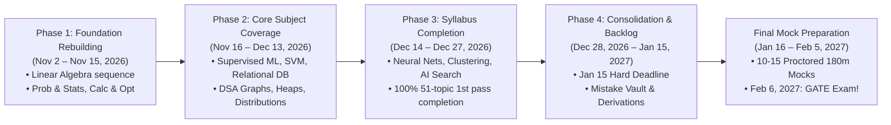

# GATE 2027 Command Centre: Complete Syllabus & Personalized Execution Plan

> **Target Examination:** GATE 2027 — Data Science & Artificial Intelligence (DA)  
> **Official Exam Date:** February 6, 2027 (09:30 AM IST)  
> **Preparation Start Date:** November 2, 2026  
> **Syllabus Target Completion Deadline:** January 15, 2027 (Hard Deadline)  
> **Total Curriculum Scope:** 7 Subjects | 20 Chapters | 51 Topics | 299 Estimated Focused Hours  
> **Weekly Study Capacity:** 39.0 Focused Hours (Mon–Sat: 6.0h / day, Sun: 3.0h revision)  
> **Primary Target:** 80+ Marks (All India Rank < 100)  
> **Timezone:** Asia/Kolkata (IST)  
> **Live Web Application:** [https://sankeerth28.github.io/GATE-Command-Centre/](https://sankeerth28.github.io/GATE-Command-Centre/)  
> **GitHub Repository:** [https://github.com/Sankeerth28/GATE-Command-Centre](https://github.com/Sankeerth28/GATE-Command-Centre)

---

## 1. Executive Summary & Strategy Overview

The **GATE Command Centre** is engineered to replace disorganized exam prep with an automated, algorithmically balanced study and revision operating system tailored specifically for **GATE DA 2027**.

The preparation architecture implements five core operational pillars:
1. **Canonical GATE DA Syllabus Mapping:** All 7 official subjects, 20 chapters, and 51 topics mapped with explicit subtopic checklists, exam weightages, priorities, and difficulty ratings.
2. **Weekly 39-Hour Timetable Matrix:** A multi-subject weekly distribution allocating 39 focused hours across all 7 subjects (Probability & Statistics 6h, Linear Algebra 6h, Calculus & Optimization 4.5h, Programming & DSA 6h, DBMS 5h, Machine Learning & AI 7h, General Aptitude 4.5h).
3. **Phase-Driven Milestone Progression:** Four preparation phases spanning Nov 2, 2026 to Jan 15, 2027, followed by a dedicated Full-Length Mock Examination period (Jan 16 – Feb 5, 2027) targeting 10–15 proctored mocks.
4. **Linear Algebra Foundational Rebuilding:** Rigorous re-assessment and sequential coverage of Linear Algebra across 6 core modules before advanced ML applications.
5. **Zero-Loss Mistake Vault & Spaced Repetition (SRS):** Questions answered incorrectly during practice or mocks are categorized across 5 root causes in the Mistake Vault, while Leitner SRS mathematically schedules topic revisions at 1, 3, 7, 14, 30, and 90-day intervals.

---

## 2. Official GATE DA Syllabus Breakdown

```
Total Curriculum Scope: 299 Hours | 20 Chapters | 51 Topics | 100 Marks
├── 1. Probability & Statistics (PROB_STAT)       [16 Marks | 3 Chapters | 8 Topics  | 48 Hours | 6.0 h/week]
├── 2. Linear Algebra (LIN_ALG)                   [14 Marks | 2 Chapters | 6 Topics  | 37 Hours | 6.0 h/week]
├── 3. Calculus & Optimization (CALC_OPT)         [12 Marks | 3 Chapters | 6 Topics  | 34 Hours | 4.5 h/week]
├── 4. Programming, Data Structures (PROG_DSA)    [16 Marks | 3 Chapters | 8 Topics  | 47 Hours | 6.0 h/week]
├── 5. Database Management & Warehousing (DBMS)   [12 Marks | 3 Chapters | 7 Topics  | 39 Hours | 5.0 h/week]
├── 6. Machine Learning & AI (ML_AI)              [16 Marks | 3 Chapters | 10 Topics | 61 Hours | 7.0 h/week]
└── 7. General Aptitude (GEN_APT)                 [15 Marks | 3 Chapters | 6 Topics  | 33 Hours | 4.5 h/week]
```

### Subject Overview & Diagnostic Baselines

| Code | Subject Name | Exam Weight | Baseline Diagnostic | App Weekly Allocation | Chapters | Topics | Est. Total Hours |
| :--- | :--- | :---: | :--- | :---: | :---: | :---: | :---: |
| `PROB_STAT` | **Probability and Statistics** | 16% | **Weak** (Foundational priority) | **6.0 h / wk** | 3 | 8 | 48.0 h |
| `LIN_ALG` | **Linear Algebra** | 14% | **Intermediate** (Requires rigor & PYQs) | **6.0 h / wk** | 2 | 6 | 37.0 h |
| `CALC_OPT` | **Calculus and Optimization** | 12% | **Weak** (High mathematical friction) | **4.5 h / wk** | 3 | 6 | 34.0 h |
| `PROG_DSA` | **Programming, DSA** | 16% | **Intermediate** (Python & algorithmic speed) | **6.0 h / wk** | 3 | 8 | 47.0 h |
| `DBMS_DWH` | **Database Management & DWH** | 12% | **Weak** (Relational algebra & SQL focus) | **5.0 h / wk** | 3 | 7 | 39.0 h |
| `ML_AI` | **Machine Learning & AI** | 16% | **Intermediate** (Mathematical derivations) | **7.0 h / wk** | 3 | 10 | 61.0 h |
| `GEN_APT` | **General Aptitude** | 15% | **Intermediate** (Weekly speed practice) | **4.5 h / wk** | 3 | 6 | 33.0 h |
| **TOTAL** | **Full GATE DA Curriculum** | **100%** | **Personalized Dynamic Balance** | **39.0 h / wk** | **20** | **51** | **299.0 h** |

---

## 3. Comprehensive Topic & Subtopic Catalog

### Subject 1: Probability and Statistics (`PROB_STAT`)
- **Exam Weightage:** 16.0%  
- **Diagnostic Baseline:** Weak - Requires structured preparation  
- **Estimated Study Time:** 48.0 Hours across 8 Topics  

#### Chapter 1.1: Probability Theory
1. **Counting and Combinatorics** [4.0 h | Priority: Medium | Difficulty: Medium]
   - Permutations and Combinations
   - Pigeonhole Principle
   - Inclusion-Exclusion Principle
2. **Axioms of Probability & Conditional Probability** [5.0 h | Priority: High | Difficulty: Medium]
   - Sample Space and Probability Axioms
   - Conditional Probability & Independence
   - Total Probability Theorem
   - Bayes' Theorem & Posterior Odds

#### Chapter 1.2: Random Variables & Distributions
3. **Discrete Random Variables & Distributions** [7.0 h | Priority: High | Difficulty: Medium]
   - PMF and CDF of Discrete Variables
   - Expectation, Variance and Moments
   - Bernoulli and Binomial Distributions
   - Poisson and Geometric Distributions
4. **Continuous Random Variables & Distributions** [8.0 h | Priority: High | Difficulty: Hard]
   - PDF, CDF and Quartiles
   - Expectation and Variance of Continuous Variables
   - Uniform Distribution
   - Normal (Gaussian) Distribution & Standard Normal
   - Exponential Distribution & Memoryless Property
5. **Joint Probability Distributions** [7.0 h | Priority: High | Difficulty: Hard]
   - Joint, Marginal and Conditional PMF/PDF
   - Independence of Random Variables
   - Covariance and Pearson Correlation
   - Conditional Expectation and Variance

#### Chapter 1.3: Mathematical Statistics & Inference
6. **Limit Theorems & Inequalities** [5.0 h | Priority: High | Difficulty: Medium]
   - Markov and Chebyshev's Inequalities
   - Weak and Strong Law of Large Numbers
   - Central Limit Theorem (CLT)
7. **Statistical Estimation & Inference** [6.0 h | Priority: High | Difficulty: Hard]
   - Point Estimation & Unbiasedness
   - Maximum Likelihood Estimation (MLE)
   - Confidence Intervals for Means and Proportions
8. **Hypothesis Testing** [6.0 h | Priority: High | Difficulty: Hard]
   - Null & Alternative Hypotheses, Type I & II Errors
   - Significance Levels and p-values
   - z-Test and One/Two-Sample t-Test
   - Chi-Square Goodness-of-Fit and Independence Test

---

### Subject 2: Linear Algebra (`LIN_ALG`)
- **Exam Weightage:** 14.0%  
- **Diagnostic Baseline:** Intermediate - Previously studied; requires revision & PYQs  
- **Estimated Study Time:** 37.0 Hours across 6 Topics  

#### Chapter 2.1: Vector Spaces & Linear Systems
1. **Vector Spaces and Subspaces** [6.0 h | Priority: High | Difficulty: Medium]
   - Vector Spaces Definition and Properties
   - Subspaces and Linear Combinations
   - Linear Independence and Span
   - Basis, Dimension and Coordinate Systems
2. **Matrices & Systems of Linear Equations** [6.0 h | Priority: High | Difficulty: Medium]
   - Elementary Row Operations & Row Echelon Form
   - Gaussian Elimination and Gauss-Jordan
   - Rank, Nullity and Rank-Nullity Theorem
   - Consistency & Solutions of Linear Systems

#### Chapter 2.2: Transformations, Eigenvalues & Factorizations
3. **Linear Transformations & Matrix Representations** [5.0 h | Priority: Medium | Difficulty: Medium]
   - Kernel and Range of Linear Transformations
   - Matrix Representations of Transformations
   - Change of Basis and Invertible Transformations
4. **Eigenvalues, Eigenvectors & Diagonalization** [7.0 h | Priority: High | Difficulty: Hard]
   - Characteristic Polynomial and Roots
   - Algebraic and Geometric Multiplicity
   - Diagonalization and Spectral Theorem for Symmetric Matrices
   - Trace, Determinant and Powers of Matrices
5. **Orthogonality & Projections** [6.0 h | Priority: High | Difficulty: Medium]
   - Inner Products and Norms
   - Cauchy-Schwarz Inequality
   - Orthogonal and Orthonormal Sets
   - Gram-Schmidt Orthogonalization Process
   - Orthogonal Projections and Least Squares
6. **Advanced Factorizations & SVD** [7.0 h | Priority: High | Difficulty: Hard]
   - Singular Value Decomposition (SVD)
   - Singular Values, Left/Right Singular Vectors
   - Low-Rank Approximations and PCA Connection
   - LU and Cholesky Decompositions

---

### Subject 3: Calculus and Optimization (`CALC_OPT`)
- **Exam Weightage:** 12.0%  
- **Diagnostic Baseline:** Weak - Requires foundational learning and practice  
- **Estimated Study Time:** 34.0 Hours across 6 Topics  

#### Chapter 3.1: Single Variable Calculus
1. **Limits, Continuity and Differentiability** [5.0 h | Priority: Medium | Difficulty: Medium]
   - Limits and Indeterminate Forms (L'Hopital's Rule)
   - Continuity and Discontinuity Types
   - Differentiability and Derivative Rules
   - Rolle's and Mean Value Theorems
2. **Taylor Series & Local Approximations** [4.0 h | Priority: Medium | Difficulty: Medium]
   - Taylor and Maclaurin Series
   - Linear and Quadratic Approximations
   - Error Bounds and Truncation
3. **Maxima and Minima of Single Variable** [5.0 h | Priority: High | Difficulty: Medium]
   - Critical Points and Local/Global Extrema
   - First and Second Derivative Tests
   - Concavity and Points of Inflection

#### Chapter 3.2: Multivariable Calculus
4. **Partial Derivatives, Gradients & Hessian** [6.0 h | Priority: High | Difficulty: Hard]
   - Partial Derivatives and Multivariable Chain Rule
   - Directional Derivatives and Gradient Vector
   - Tangent Planes and Linear Approximations
   - Hessian Matrix and Second Order Derivatives

#### Chapter 3.3: Mathematical Optimization
5. **Unconstrained Optimization & Gradient Descent** [7.0 h | Priority: High | Difficulty: Hard]
   - Convex Sets and Convex Functions
   - First and Second Order Optimality Conditions
   - Gradient Descent and Step Size
   - Stochastic and Batch Gradient Descent
6. **Constrained Optimization & Lagrange Multipliers** [7.0 h | Priority: High | Difficulty: Hard]
   - Equality Constraints and Lagrange Multipliers
   - Inequality Constraints and KKT Conditions
   - Primal and Dual Formulations

---

### Subject 4: Programming, Data Structures & Algorithms (`PROG_DSA`)
- **Exam Weightage:** 16.0%  
- **Diagnostic Baseline:** Intermediate  
- **Estimated Study Time:** 47.0 Hours across 8 Topics  

#### Chapter 4.1: Python Programming
1. **Python Programming Fundamentals** [6.0 h | Priority: Medium | Difficulty: Easy]
   - Data Types, Operators and Flow Control
   - Lists, Tuples, Dictionaries, Sets and Comprehensions
   - Functions, Arguments, Scope and Recursion
   - OOP Concepts: Classes, Objects, Inheritance

#### Chapter 4.2: Data Structures
2. **Linear Data Structures** [5.0 h | Priority: High | Difficulty: Medium]
   - Arrays and Dynamic Arrays
   - Singly and Doubly Linked Lists
   - Stacks, Queues and Deques
   - Stack and Queue Applications
3. **Trees & Binary Search Trees** [7.0 h | Priority: High | Difficulty: Hard]
   - Tree Traversals (Inorder, Preorder, Postorder, Level)
   - Binary Search Tree (BST) Operations
   - Balanced Trees Concept (AVL, Red-Black)
   - Tree Height, Depth and Diameter
4. **Heaps and Priority Queues** [4.0 h | Priority: High | Difficulty: Medium]
   - Binary Heap Representation (Min/Max Heap)
   - Heapify and Build Heap Operations
   - Heap Sort Algorithm
   - Priority Queue Implementation
5. **Hashing and Graph Representations** [5.0 h | Priority: High | Difficulty: Medium]
   - Hash Functions and Collision Resolution
   - Chaining vs Open Addressing
   - Graph Representations (Adjacency Matrix & List)

#### Chapter 4.3: Algorithms & Complexity
6. **Asymptotic Analysis & Sorting/Searching** [5.0 h | Priority: High | Difficulty: Medium]
   - Asymptotic Notations (Big O, Omega, Theta)
   - Solving Recurrence Relations (Master Theorem)
   - Linear and Binary Search
   - Merge Sort, Quick Sort and Comparative Analysis
7. **Algorithmic Paradigms** [8.0 h | Priority: High | Difficulty: Hard]
   - Divide and Conquer Strategy
   - Greedy Method and Optimal Substructure
   - Dynamic Programming (Memoization & Tabulation)
   - Classic DP: LCS, 0/1 Knapsack, Matrix Chain Multiplication
8. **Graph Traversal & Shortest Paths** [7.0 h | Priority: High | Difficulty: Hard]
   - Breadth-First Search (BFS) and Applications
   - Depth-First Search (DFS) and Topological Sort
   - Dijkstra's Shortest Path Algorithm
   - Bellman-Ford Algorithm
   - Minimum Spanning Trees (Prim's & Kruskal's)

---

### Subject 5: Database Management & Data Warehousing (`DBMS_DWH`)
- **Exam Weightage:** 12.0%  
- **Diagnostic Baseline:** Weak - Requires structured concept preparation  
- **Estimated Study Time:** 39.0 Hours across 7 Topics  

#### Chapter 5.1: Database Design & Relational Models
1. **ER Modeling & Relational Model** [5.0 h | Priority: Medium | Difficulty: Medium]
   - Entity-Relationship (ER) Concepts
   - ER-to-Relational Schema Mapping
   - Integrity Constraints and Candidate/Foreign Keys
2. **Relational Algebra & Tuple Calculus** [5.0 h | Priority: High | Difficulty: Hard]
   - Fundamental Relational Algebra Operators
   - Joins: Theta, Natural, Outer Joins
   - Tuple Relational Calculus (TRC)
   - Domain Relational Calculus (DRC)

#### Chapter 5.2: SQL & Normalization
3. **Structured Query Language (SQL)** [7.0 h | Priority: High | Difficulty: Medium]
   - DDL, DML, DCL Statements
   - Complex Queries, Multi-table Joins
   - Subqueries, Correlated Subqueries, Exists
   - Aggregation, Group By, Having, Window Functions
4. **Functional Dependencies & Normalization** [6.0 h | Priority: High | Difficulty: Hard]
   - Functional Dependencies and Attribute Closure
   - Minimal Cover and Candidate Key Finding
   - 1NF, 2NF, 3NF and BCNF
   - Lossless Join and Dependency Preserving Decompositions

#### Chapter 5.3: Transactions, Indexing & Data Warehousing
5. **Transactions & Concurrency Control** [6.0 h | Priority: High | Difficulty: Hard]
   - ACID Properties
   - Conflict and View Serializability
   - Recoverable and Cascadeless Schedules
   - Two-Phase Locking Protocol (2PL) and Deadlocks
6. **File Organization & B/B+ Trees Indexing** [5.0 h | Priority: High | Difficulty: Hard]
   - Primary, Secondary, and Clustering Indexes
   - B-Trees Structure and Properties
   - B+ Trees Insertion, Deletion and Cost Analysis
7. **Data Warehousing & OLAP** [5.0 h | Priority: Medium | Difficulty: Medium]
   - Data Warehouse Architecture and ETL Concepts
   - Multidimensional Schemas: Star, Snowflake, Galaxy
   - OLAP Operations: Drill-down, Roll-up, Slice, Dice, Pivot

---

### Subject 6: Machine Learning & Artificial Intelligence (`ML_AI`)
- **Exam Weightage:** 16.0%  
- **Diagnostic Baseline:** Intermediate - Requires GATE-oriented mathematical practice  
- **Estimated Study Time:** 61.0 Hours across 10 Topics  

#### Chapter 6.1: Supervised Learning
1. **Linear Regression & Regularization** [6.0 h | Priority: High | Difficulty: Hard]
   - Simple & Multiple Linear Regression
   - Ordinary Least Squares (OLS) Formulation
   - Ridge (L2) and Lasso (L1) Regularization
   - Bias-Variance Tradeoff and Cross-Validation
2. **Classification & Tree Models** [8.0 h | Priority: High | Difficulty: Hard]
   - Logistic Regression & Decision Boundaries
   - Decision Trees: Entropy, Information Gain, Gini
   - Overfitting and Tree Pruning
   - Random Forests, Bagging and Gradient Boosting
3. **k-Nearest Neighbors & Naive Bayes** [5.0 h | Priority: Medium | Difficulty: Medium]
   - k-NN Distance Metrics and Choice of k
   - Bayes Decision Rule and Maximum a Posteriori (MAP)
   - Naive Bayes Classifier (Gaussian & Multinomial)
4. **Support Vector Machines (SVM)** [6.0 h | Priority: High | Difficulty: Hard]
   - Maximal Margin Hyperplane and Support Vectors
   - Soft-Margin Formulation and Slack Variables
   - Kernel Trick (Polynomial, RBF Kernels)

#### Chapter 6.2: Unsupervised Learning & Deep Learning
5. **Clustering Algorithms** [6.0 h | Priority: Medium | Difficulty: Medium]
   - k-Means and k-Means++ Clustering
   - Objective Function and Elbow Method
   - Hierarchical Clustering (Agglomerative, Dendrograms)
   - DBSCAN Density-Based Clustering
6. **Dimensionality Reduction & PCA** [5.0 h | Priority: High | Difficulty: Hard]
   - Curse of Dimensionality
   - Principal Component Analysis (PCA) Derivation
   - Covariance Matrix and Eigenvector Projection
   - Explained Variance and Reconstruction Error
7. **Multilayer Perceptron & Neural Networks** [7.0 h | Priority: High | Difficulty: Hard]
   - Perceptron and Linear Separability
   - Multilayer Perceptron (MLP) Architecture
   - Activation Functions (Sigmoid, Tanh, ReLU, Softmax)
   - Loss Functions (MSE, Cross-Entropy)
8. **Backpropagation & Deep Learning Optimization** [7.0 h | Priority: High | Difficulty: Hard]
   - Backpropagation Derivation and Gradient Flow
   - Optimizers: SGD, Momentum, RMSprop, Adam
   - Regularization: Dropout, L1/L2, Batch Normalization
   - Vanishing and Exploding Gradients

#### Chapter 6.3: Artificial Intelligence & Search
9. **Search Algorithms & Heuristics** [6.0 h | Priority: High | Difficulty: Medium]
   - State Space, States, Actions, Path Cost
   - Uninformed Search: BFS, DFS, Uniform Cost Search
   - Informed Search: A* Search, Heuristic Admissibility
   - Consistency and Optimality of A*
10. **Adversarial Search & Game Playing** [5.0 h | Priority: Medium | Difficulty: Hard]
   - Game Trees and Optimal Decisions
   - Minimax Algorithm Formulation
   - Alpha-Beta Pruning Technique and Efficiency

---

### Subject 7: General Aptitude (`GEN_APT`)
- **Exam Weightage:** 15.0%  
- **Diagnostic Baseline:** Intermediate - Requires consistent weekly practice  
- **Estimated Study Time:** 33.0 Hours across 6 Topics  

#### Chapter 7.1: Verbal Aptitude
1. **English Grammar & Vocabulary** [5.0 h | Priority: Medium | Difficulty: Easy]
   - Tenses, Prepositions, Conjunctions
   - Subject-Verb Agreement and Articles
   - Vocabulary, Idioms and Phrasal Verbs
2. **Reading Comprehension & Critical Reasoning** [6.0 h | Priority: High | Difficulty: Medium]
   - Passage Analysis and Central Idea
   - Inference and Logical Deductions
   - Sentence Completion and Ordering

#### Chapter 7.2: Quantitative Aptitude
3. **Numerical Computation & Word Problems** [7.0 h | Priority: High | Difficulty: Medium]
   - Percentages, Ratios and Proportions
   - Profit and Loss, Simple and Compound Interest
   - Time, Speed and Distance; Time and Work
   - Permutations, Combinations and Elementary Probability
4. **Data Interpretation & Statistics** [6.0 h | Priority: High | Difficulty: Medium]
   - Tables and Column Charts
   - Bar Charts, Pie Charts and Line Graphs
   - Summary Statistics: Mean, Median, Mode

#### Chapter 7.3: Analytical & Spatial Aptitude
5. **Analytical & Logical Reasoning** [5.0 h | Priority: High | Difficulty: Medium]
   - Syllogisms and Deductive Logic
   - Seating Arrangement and Blood Relations
   - Number and Pattern Series
6. **Spatial Aptitude** [4.0 h | Priority: Medium | Difficulty: Medium]
   - Transformation of 2D and 3D Shapes
   - Paper Folding, Cutting and Assembly
   - Patterns, Mirror Images and Rotations

---

---

## 4. The 5-Phase Personalized Execution Plan



### Phase 1: Foundation Rebuilding (November 2 – November 15, 2026)
- **Primary Objectives:**
  - Rebuild Linear Algebra from fundamentals using the strict 6-module sequence.
  - Begin Probability & Statistics (Combinatorics, Axioms, Conditional Probability).
  - Begin Calculus & Optimization (Limits, continuity, differentiation, single-variable max/min).
  - Continue Programming and DSA (Python syntax, arrays, linked lists, basic sorting).
  - Maintain regular DBMS and ML exposure.
- **Key Milestones:**
  - Linear Algebra vector spaces and row echelon forms consolidated.
  - Baseline confidence reassessment completed for all foundational topics.

### Phase 2: Core Subject Coverage (November 16 – December 13, 2026)
- **Primary Objectives:**
  - Complete the remainder of Linear Algebra (Eigenvalues, SVD, Orthogonality).
  - Progress through continuous probability distributions, joint distributions, and statistical inference.
  - Cover multivariable Calculus, gradients, and unconstrained optimization.
  - Cover DSA trees, heaps, graphs, hashing, and asymptotic analysis.
  - Cover relational algebra, SQL queries, B+ tree indexing, normalization, and ACID transactions.
  - Cover supervised Machine Learning (Linear regression, Logistic regression, SVM, Decision Trees).
- **Key Milestones:**
  - Regular PYQ practice alongside concept learning.
  - $\ge 60\%$ of total syllabus topics marked as learning complete.

### Phase 3: Remaining Syllabus Completion (December 14 – December 27, 2026)
- **Primary Objectives:**
  - Deep Learning and Multi-Layer Perceptrons (Feedforward, backpropagation).
  - Unsupervised learning (PCA, $k$-Means, Hierarchical clustering).
  - AI Search algorithms (Informed/Uninformed, A*, Adversarial minimax search).
  - Remaining DBMS topics (Data Warehousing, ER models, schema design).
  - Remaining Probability topics (Hypothesis testing, limit theorems) and multivariable optimization.
  - Sectional tests and topic-wise PYQs.
- **Key Milestones:**
  - **December 27 Milestone:** 100% first learning pass across all 51 syllabus topics completed.

### Phase 4: Consolidation and Backlog Closure (December 28, 2026 – January 15, 2027)
- **Primary Objectives:**
  - Finish any incomplete topics and resolve pending PYQ queues.
  - Rigorous revision of mathematical derivations and proofs.
  - Systematic resolution of all entries in the Mistake Vault.
  - High-yield sectional tests and weak-topic remediation sprints.
  - Consolidation and memorization of mathematical formula sheets.
- **Key Milestones:**
  - **January 15, 2027:** Hard syllabus closure deadline. Zero unfinished syllabus items beyond this date.

### Final Examination Preparation (January 16 – February 5, 2027)
- **Primary Objectives:**
  - Full-length 180-minute GATE DA mock examinations scheduled on Wednesdays and Saturdays (09:30 AM – 12:30 PM).
  - Dedicated 3-hour mock analysis session following every mock test.
  - Rapid multi-subject revision rotations across all 7 subjects.
  - Elimination of recurring negative marking traps and speed calibration.
- **Target:** At least 10 rigorously analyzed full-length mocks (15 as stretch target).
- **GATE Examination Date:** February 6, 2027 (09:30 AM IST).

---

## 5. Recurring Weekly Timetable (39.0 Focused Hours)

The preparation planner follows a strict weekly 39.0-hour allocation matrix (Monday through Saturday: 6.0 hours/day; Sunday: 3.0 lighter revision hours):

| Day | Capacity | Scheduled Subject Modules & Allocation |
| :--- | :---: | :--- |
| **Monday** | 6.0 h | • Probability and Statistics: 2.0 h<br>• Linear Algebra: 2.0 h<br>• Programming and DSA: 2.0 h |
| **Tuesday** | 6.0 h | • Probability and Statistics: 2.0 h<br>• Calculus and Optimization: 2.0 h<br>• Database Management & DWH: 2.0 h |
| **Wednesday** | 6.0 h | • Linear Algebra: 2.0 h<br>• Machine Learning and AI: 2.0 h<br>• General Aptitude: 1.0 h<br>• Database Management & DWH: 1.0 h |
| **Thursday** | 6.0 h | • Calculus and Optimization: 2.0 h<br>• Programming and DSA: 2.0 h<br>• Machine Learning and AI: 2.0 h |
| **Friday** | 6.0 h | • Probability and Statistics: 2.0 h<br>• Database Management & DWH: 2.0 h<br>• Linear Algebra: 1.0 h<br>• General Aptitude: 1.0 h |
| **Saturday** | 6.0 h | • Machine Learning and AI: 2.0 h<br>• Programming and DSA: 2.0 h<br>• Calculus and Optimization: 0.5 h<br>• General Aptitude: 1.5 h |
| **Sunday** | 3.0 h | • Linear Algebra: 1.0 h<br>• Machine Learning and AI: 1.0 h<br>• General Aptitude: 1.0 h<br>*(Prioritizes weekly revision, PYQ consolidation, backlog reflow & weekly performance analysis)* |
| **TOTAL** | **39.0 h** | **PROB: 6h \| LIN_ALG: 6h \| CALC: 4.5h \| DSA: 6h \| DBMS: 5h \| ML_AI: 7h \| APT: 4.5h** |

### Linear Algebra — Sequential Revision Sequence
Because Linear Algebra is a foundational re-study subject, it is strictly sequenced as follows:
1. **Vector Spaces and Subspaces:** Axioms, Real Euclidean spaces $\mathbb{R}^n$, Subspaces, Linear span, Linear independence/dependence, Basis and dimension.
2. **Matrices and Systems of Linear Equations:** Row echelon form (REF), Reduced REF, Gaussian elimination, Rank-nullity theorem, Consistency ($Ax = b$).
3. **Linear Transformations:** Kernel, image, matrix representation, change of basis, similarity transformations.
4. **Eigenvalues and Eigenvectors:** Characteristic polynomials, algebraic/geometric multiplicity, diagonalization, Cayley-Hamilton theorem.
5. **Orthogonality and Projections:** Inner products, Cauchy-Schwarz, Gram-Schmidt orthogonalization, orthogonal projection matrices, least-squares solutions.
6. **Advanced Factorizations and SVD:** Singular Value Decomposition ($U \Sigma V^T$), low-rank approximations, PCA connections, LU decomposition, Cholesky factorization.

### Supported Work Item Session Types
The planner and timer support 8 explicit session types for complete tracking fidelity:
1. `CONCEPT_LEARNING`: Core theory and initial concept assimilation.
2. `DERIVATION_PRACTICE`: Step-by-step mathematical proofs and manual derivation.
3. `PYQ_PRACTICE`: Solving official GATE/CS/DA prior-year questions.
4. `FORMULA_REVISION`: High-speed formula flashcard and journal review.
5. `MISTAKE_REVISION`: Re-solving questions from the Mistake Vault without notes.
6. `WEAK_TOPIC_REVISION`: Targeted remediation for topics rated Weak or Average.
7. `MOCK_TEST`: Timed 180-minute full mock examination or 60-minute sectional test.
8. `MOCK_ANALYSIS`: Detailed 3-hour post-mock analysis and error classification.

### Daily Workload Capacity Safeguards
- **Daily Capacity Target:** 6.0 Hours / day (Mon–Sat), 3.0 Hours (Sun).
- **Hard Capacity Ceiling:** 8.0 Hours / day.
- **Smart Reflow Algorithm:** Incomplete tasks are rescheduled forward respecting daily ceilings (3h on Sun, 6h on Mon-Sat). If total required backlog exceeds available days to January 15, the system raises a visible deficit warning banner.

---

## 6. Spaced Repetition (SRS) Engine

The system prevents syllabus forgetting using an adaptive Leitner spaced repetition model. When you rate your understanding of a topic after a study block or evening review, the system automatically calculates the next revision date:

$$\text{Next Revision Date} = \text{Current Date} + \Delta_{\text{confidence}}[\min(\text{Revision Count}, \text{Max Level})]$$

| Confidence Rating | Spaced Intervals (Days) | Trigger Meaning |
| :--- | :--- | :--- |
| **Weak** | `[1]` (Tomorrow) | Significant conceptual friction. Requires immediate next-day re-study. |
| **Average** | `[3]` | Understood core theorem, but struggled with algebraic derivations or edge cases. |
| **Good** | `[1, 3, 7, 14, 30]` | Standard Leitner progression. Expands interval exponentially upon each success. |
| **Strong** | `[21, 45, 90]` | Fully mastered. Long-range memory retention check. |

*Mastery Criteria:* Any topic that achieves **3 consecutive "Strong" reviews** with $\ge 20$ PYQs solved is automatically upgraded to the **`Mastered`** status.

---

## 7. Official GATE DA Scoring & Negative Marking Engine

Full-length and sectional mocks are evaluated with the official GATE marking criteria:

$$\text{Net Score} = \sum \text{Gross Marks Obtained} - \sum \text{Negative Marks Lost}$$

| Question Type | Correct Answer | Incorrect Answer | Unattempted |
| :--- | :---: | :---: | :---: |
| **1-Mark Multiple Choice (MCQ)** | $+1.00$ | $-\frac{1}{3} \approx -0.333$ | $0.00$ |
| **2-Mark Multiple Choice (MCQ)** | $+2.00$ | $-\frac{2}{3} \approx -0.667$ | $0.00$ |
| **Multiple Select Question (MSQ)** | $+1.00$ or $+2.00$ | **$0.00$** (No negative marks) | $0.00$ |
| **Numerical Answer Type (NAT)** | $+1.00$ or $+2.00$ | **$0.00$** (No negative marks) | $0.00$ |

### Key Benchmark Targets for AIR < 100
- **Attempt Rate:** $\ge 85\%$ (55+ of 65 questions).
- **Accuracy Rate:** $\ge 82\%$ on attempted questions.
- **Negative Marks Lost:** $< 4.0$ marks per full paper.
- **Gross Target Score:** $82.00 / 100$.

---

## 8. The Mistake Vault Remediation Loop

Whenever a mock test is submitted or practice errors occur, incorrect questions are logged to the **Mistake Vault** and categorized into one of five root causes:

1. **Conceptual Gap:** Core theorem or rule was misunderstood (e.g., confusing Bayes' rule conditions or positive definiteness criteria).
2. **Formula or Theorem Forgetting:** Failed to recall an identity, CDF formula, or normalization definition.
3. **Calculation or Algebra Error:** Mathematical slip, matrix multiplication blunder, or sign error.
4. **Question Misinterpretation:** Misread "NOT true", missed boundary conditions, or unit error.
5. **Time Pressure or Guessing:** Rushed during final 15 minutes or took an unwarranted gamble.

*Resolution Protocol:* A mistake is only marked **Resolved** once you re-solve it from scratch without notes, write the corrected takeaway in the **Solution Notes**, and successfully answer an equivalent problem.

---

## 9. Application Feature Mapping & Execution Workflows

| App Page / Feature | Key Capabilities & Algorithmic Logic |
| :--- | :--- |
| **Dashboard** (`/`) | • Real-time countdown to Feb 6, 2027 (09:30 AM IST) and Jan 15, 2027 syllabus deadline.<br>• Phase progress pill (Phase 1 through Final Mock Phase) & next milestone.<br>• Deficit Warning Banner if required study hours exceed available daily/weekly capacity.<br>• 39h Weekly actual vs target study hours bar (Mon–Sun).<br>• Academic Readiness Scorecard (Weighted completion %, Mastered topics, Pending PYQs, Overdue SRS, Unresolved mistakes, Latest mock score). |
| **Daily Planner** (`/planner`) | • Calendar day picker, today jump, and week view.<br>• 6.0h daily capacity target (Mon–Sat), 3.0h (Sun).<br>• 8 supported session types with color-coded badges.<br>• Morning Check-in Modal (07:30 IST) & Evening Review Modal (21:30 IST).<br>• One-click **Smart Reflow** button to redistribute pending backlog forward. |
| **Syllabus Tracker** (`/syllabus`) | • 7 subjects, 20 chapters, 51 topics with status filtering (`Not Started`, `In Progress`, `Mastered`).<br>• Subtopic checklists with progress recalculation.<br>• PYQ counter (target 20 per topic).<br>• Confidence rating buttons (Weak, Average, Good, Strong) linked to Leitner SRS revision calculation. |
| **Focus Timer** (Global Bar & Modal) | • Floating bottom widget with full-screen focus modal.<br>• Pomodoro (25/5 min), Deep Work (50/10 min), and Stopwatch modes.<br>• Session type inherited from active task.<br>• Question practice counter with automatic topic actual hours sync. |
| **Mistake Vault** (`/mistakes`) | • Error logging with 5 root causes, difficulty, and question source.<br>• LaTeX math formula support in problem statements and solution notes.<br>• Re-solve verification to mark errors as Resolved. |
| **Mock Exam Centre** (`/mocks`) | • Official GATE DA scoring calculator (+1, +2 MCQ with negative marking, MSQ/NAT with 0 negative).<br>• Track score progression towards 80+ marks target.<br>• 3-hour post-mock analysis logging directly to the Mistake Vault. |
| **Formula & Study Journal** (`/journal`) | • Formula flashcard repository with LaTeX / KaTeX rendering.<br>• Derivation step-by-step logs.<br>• Daily reflection and concept note entries. |
| **Analytics & Diagnostics** (`/analytics`) | • 7-subject radar and bar breakdowns (Actual vs Estimated hours, PYQ completion rate).<br>• Leitner SRS retention curves.<br>• Error taxonomy distribution donut chart. |
| **Settings & Backups** (`/settings`) | • Target exam date, prep start date, syllabus deadline pickers.<br>• Configurable subject weekly hours editor with live 39.0h sum validator.<br>• Diagnostic baselines editor for all 7 subjects.<br>• Non-destructive JSON Backup Export & Restore. |

---

## 10. Data Ownership & Access Instructions

Your preparation progress is 100% yours and accessible both online and offline:

- **Online Live Web App:** [https://sankeerth28.github.io/GATE-Command-Centre/](https://sankeerth28.github.io/GATE-Command-Centre/)
- **Local Application:** Run `npm --prefix frontend run dev` and `uvicorn app.main:app` to use your local SQLite database (`gate_command_centre.db`).
- **Data Backup:** At any time, navigate to **Settings & Data Management** $\rightarrow$ click **Export JSON Backup** to save a complete, portable snapshot of your preparation journey.
